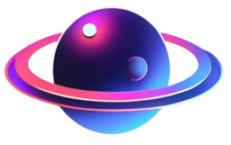
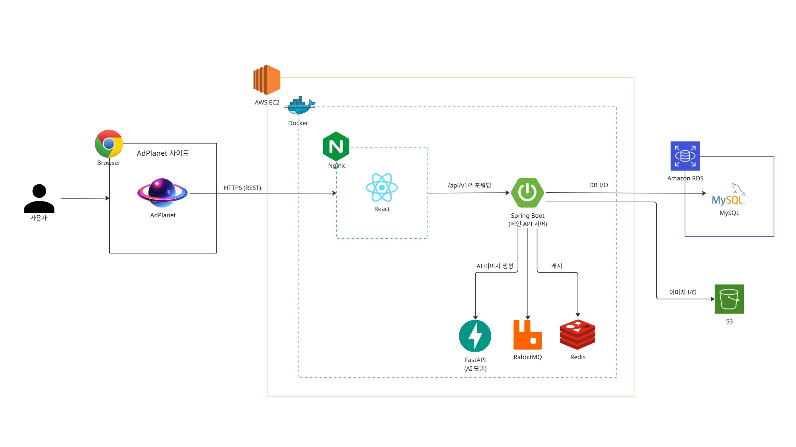

# AdPlanet

### 생성형 AI 기반 브랜드 디자인 및 워터마크 솔루션
초기 창작자와 스타트업을 위한 로고·광고 포스터 원스톱 생성 및 저작권 보호 플랫폼

 

 

 

## 개요

AdPlanet은 전문 디자이너 고용에 어려움을 겪는 초기 스타트업과 개인 창작자를 위한 생성형 AI 기반 브랜드 디자인 플랫폼입니다.

- **프롬프트 기반 로고 및 CI 가이드라인 자동화**: 간단한 키워드와 추천 스타일을 통해 브랜드 로고를 생성하고, 벡터 포맷(SVG) 변환과 색상 규격이 담긴 CI 가이드라인을 원스톱으로 제공합니다.
- **정밀 구도 제어 기반 광고 포스터 제작**: ControlNet(OpenPose)을 활용해 모델의 구도와 포즈를 정밀 제어하고, 실제 상품 사진 합성 및 카피라이팅 편집을 결합한 맞춤형 포스터를 생성합니다.
- **스테가노그래피 비가시성 디지털 워터마크**: 생성된 모든 시각 자산에 LSB(최하위 비트) 기법으로 생성자 및 라이선스 메타데이터를 육안에 보이지 않게 삽입하여 무단 도용 방지 및 저작권 추적을 지원합니다.

## 시스템 아키텍처

### 아키텍처 구성 요소

1. **프론트엔드 (React & Three.js)**
   - Three.js 기반 3D 인터랙티브 행성 캔버스 구현 및 우주 테마 UI 제공
   - React 및 TypeScript 기반 브랜드 자산 제작, 커스텀 텍스트 에디터 및 실시간 미리보기 환경 구성

2. **백엔드 (Spring Boot & RabbitMQ)**
   - 회원 인증(SSAFY OAuth 2.0) 및 JWT 기반 보안 세션 관리
   - RabbitMQ 메시지 큐를 통한 비동기 생성 작업 분산 및 백그라운드 태스크 부하 제어
   - WebClient를 활용한 AI 추론 서버(FastAPI) 및 GMS LLM API 연동

3. **생성형 AI 엔진 (Python FastAPI)**
   - **로고 생성**: Stable Diffusion 기반 Text-to-Image 생성 및 벡터 포맷(SVG) 변환
   - **포스터 생성**: ControlNet(OpenPose) 기반 모델 포즈/구도 제어 및 상품 이미지 합성
   - **디지털 워터마크**: LSB(Least Significant Bit) 스테가노그래피 기반 비가시성 워터마크 자동 주입 및 검증

## 주요 기능 및 화면

### 1. Three.js 기반 인터랙티브 메인 및 디자인 라이브러리
Three.js 기반의 3D 행성 캔버스를 통해 각 기능 행성으로 이동하고, 생성된 디자인 자산을 라이브러리에서 탐색할 수 있습니다.

| 3D 인터랙티브 메인 | 디자인 라이브러리 전체 뷰 |
| :---: | :---: |
|  |  |
| 3D 행성 캔버스 탐색 및 기능별 행성 이동 | 마우스 휠 및 드래그 기반 생성 디자인 자산 탐색 |

### 2. AI 로고 생성 및 다중 포맷 내보내기
선택한 스타일 프리셋과 프롬프트를 조합하여 고품질 브랜드 로고를 생성하고 필요한 포맷으로 내보냅니다.

| 추천 스타일 선택 | 프롬프트 입력 및 생성 요청 | 최종 생성 로고 확인 |
| :---: | :---: | :---: |
|  |  |  |
| 브랜드 톤앤매너에 맞춘 스타일 프리셋 지정 | 제목 및 설명 프롬프트 기반 생성 요청 | 최종 완성된 로고 디자인 검토 및 포맷별 다운로드 |

### 3. 정밀 구도 제어 기반 광고 포스터 생성
상품 및 모델 사진을 업로드하고 Reference 이미지를 통한 구도(ControlNet OpenPose)를 제어하여 맞춤형 광고 포스터를 제작합니다.

| 구도 및 포즈 레퍼런스 설정 | 생성된 포스터 합성 결과 | 광고 문구 추가 및 편집 |
| :---: | :---: | :---: |
|  |  |  |
| 모델·상품 이미지 및 ControlNet 적용 구도 지정 | 비동기 큐 처리 기반 포스터 합성 결과 확인 | 텍스트 폰트, 크기, 색상 커스텀 배치 및 카피라이팅 |

### 4. 스테가노그래피 디지털 워터마크 검증
생성된 로고와 포스터에 육안으로 보이지 않게 삽입된 LSB 디지털 워터마크를 검증하여 저작권 및 생성자 정보를 확인합니다.

| 이미지 파일 첨부 | 은닉 메타데이터 추출 및 검증 |
| :---: | :---: |
|  |  |
| 검증 대상 디자인 이미지 드래그앤드롭 업로드 | LSB 스테가노그래피 디코딩 기반 생성자·일시·위변조 확인 |

### 5. 마이페이지 및 브랜드 자산 관리
생성된 모든 디자인 자산을 카드 플립 인터랙션으로 확인하고, 자동 생성된 브랜드 CI 규정집을 열람할 수 있습니다.

| 카드 플립 상세 정보 | 자동 생성 브랜드 CI 가이드라인 | 포스터 자산 관리 |
| :---: | :---: | :---: |
|  |  |  |
| 마우스 호버 시 카드 뒷면 프롬프트 정보 노출 | 브랜드 색상 코드 및 사용 규정집 자동 확인 | 제작한 포스터 목록 필터링 및 작업 이력 조회 |

