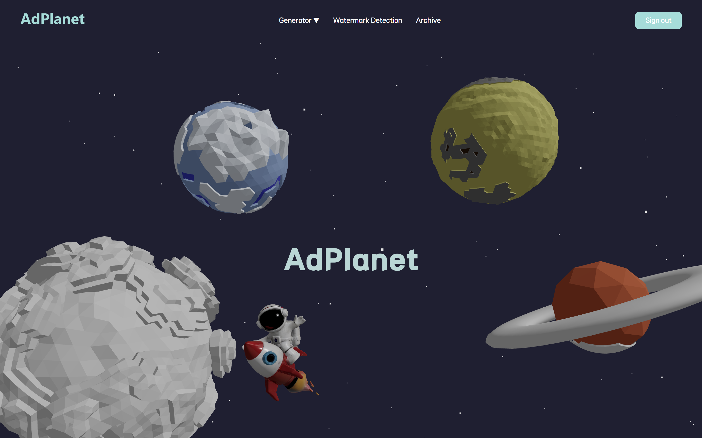

# 시연 시나리오

## 메인 화면

우측 상단 Sign in을 클릭하여 SSAFY계정으로 로그인할 수 있습니다.

행성을 선택하여 로고 생성/포스터 생성/라이브러리/워터마크 검증으로 이동할 수 있습니다.

## 라이브러리

바로가기 선택시 라이브러리를 확인할 수 있습니다.

마우스 휠 또는 드래그로 생성된 이미지를 확인할 수 있습니다.

이미지 클릭 시 확대 된 이미지가 보여집니다.

## 로고 생성

사용자는 미리 제공된 스타일을 선택하여 로고를 생성할 수 있습니다.

제목과 내용을 입력하고, 프롬프트를 작성한 뒤 ‘로고 생성하기’ 버튼을 클릭합니다.

생성이 완료되면 카테고리를 설정합니다.

완성된 로고를 확인합니다.

원하는 확장자를 선택하여 로고를 다운로드합니다.

## 포스터 생성

포스터를 생성하기 위한 화면입니다.

포스터에 들어갈 모델 이미지를 업로드 할 수 있습니다.

포스터에 들어갈 상품 이미지를 업로드 할 수 있습니다.

모델에 적용할 구도 이미지를 업로드 할 수 있습니다.

상세 프롬프트를 작성한 뒤, 포스터 생성 버튼을 클릭합니다.

포스터가 생성되는 동안 대기 화면이 로드됩니다.

포스터 생성 후, 광고 문구를 추가하거나 새로운 포스터를 생성할 수 있습니다.

광고 문구로 사용할 텍스트를 입력하고, 입력된 텍스트 크기와 색상, 굵기, 글꼴을 설정할 수 있습니다.

생성된 포스터에 태그를 지정할 수 있습니다.

## 디지털 워터마크 확인

AdPlanet 서비스 이용시 자동 주입된 워터마크를 확인할 수 있습니다.

파일을 드래그하여 첨부한 뒤, 검증하기 버튼을 클릭합니다.

검증 중에는 대기 화면이 로드됩니다.

생성된 로고와 포스터에 은닉된 정보를 확인할 수 있습니다.

## 마이페이지

### 로고

사용자가 생성한 로고 목록을 확인할 수 있습니다.

최신순 / 오래된 순 / 태그 별 필터링이 가능합니다.

마우스를 올리면 카드 뒷면의 로고 정보가 표시됩니다.

로고 카드를 클릭하면 생성 시 입력했던 제목과 프롬프트를 확인할 수 있습니다.

CI 가이드라인 생성을 위해 ‘생성하기’ 버튼을 클릭합니다.

자동 생성된 CI 가이드라인을 확인할 수 있습니다.

### 포스터

사용자가 생성한 포스터 목록을 확인할 수 있습니다.

최신순 / 오래된 순 / 태그 별 필터링이 가능합니다.

포스터를 클릭하면 생성 시 작성한 프롬프트를 확인할 수 있습니다.

포스터를 생성하며 작업한 기록을 확인할 수 있습니다.